# 使用手册

这份手册按做一集短剧的顺序走一遍：装好、连上引擎、从点子或梗概开始，一直到导出成片。
截图来自真实项目「海风吹散的初恋」（16:9，三个镜头，图和视频都用 Gemini 网页出的），界面是深色主题、1440 宽。

> 引擎怎么选、各家的时长 / 费用 / 限制，见 [引擎选择指南](engines.md)。
> 启动、备份、升级和排错见 [运维手册](../RUNBOOK.md)。

## 目录

1. [安装与启动](#1-安装与启动)
2. [加载浏览器扩展](#2-加载浏览器扩展)
3. [配置引擎（设置页）](#3-配置引擎设置页)
4. [从一个点子开始（向导）](#4-从一个点子开始向导)
5. [项目与剧集](#5-项目与剧集)
6. [剧本与剧本体检](#6-剧本与剧本体检)
7. [角色：定妆照、三视图、造型](#7-角色定妆照三视图造型)
8. [场景与道具](#8-场景与道具)
9. [分镜与镜头抽屉](#9-分镜与镜头抽屉)
10. [首帧](#10-首帧)
11. [视频与抽卡统计](#11-视频与抽卡统计)
12. [配音、配乐、字幕、片尾卡](#12-配音配乐字幕片尾卡)
13. [导出：AI 标识与元数据](#13-导出ai-标识与元数据)
14. [一键出完剩下的](#14-一键出完剩下的)
15. [任务页](#15-任务页)
16. [续季：从其他项目导入资产](#16-续季从其他项目导入资产)
17. [常见问题](#17-常见问题)

---

## 1. 安装与启动

需要 Python 3.12+ 和 [uv](https://docs.astral.sh/uv/)、Node.js 22.22+ 或 24+、ffmpeg（要带 libass，不然烧字幕和 AI 角标会失败）。
用本机 ComfyUI 出图 / 出视频还要装 [ComfyUI](https://github.com/comfyanonymous/ComfyUI) 和对应模型；只用网页版或 API 可以不装。

```bash
git clone <本仓库地址> ai_studio && cd ai_studio
uv sync
cp config.example.yaml config.yaml        # 按本机情况改，config.yaml 不进 git
cd frontend && npm install && npm run build && cd ..
uv run studio-server                      # 打开 http://127.0.0.1:8700
```

Windows 的命令、`config.yaml` 里常改的几项（ComfyUI 地址、默认文本模型、字幕字体、ffmpeg 路径）见仓库首页
[README 的快速开始](../../README.md#快速开始)。

启动后打开 http://127.0.0.1:8700 ，先到「项目中心」。左侧栏是「制作流程」（项目中心、当前集）和「系统」（任务、设置）；
顶部任务条显示正在跑的任务，有「暂停队列」「释放显存」「全部任务」三个按钮。

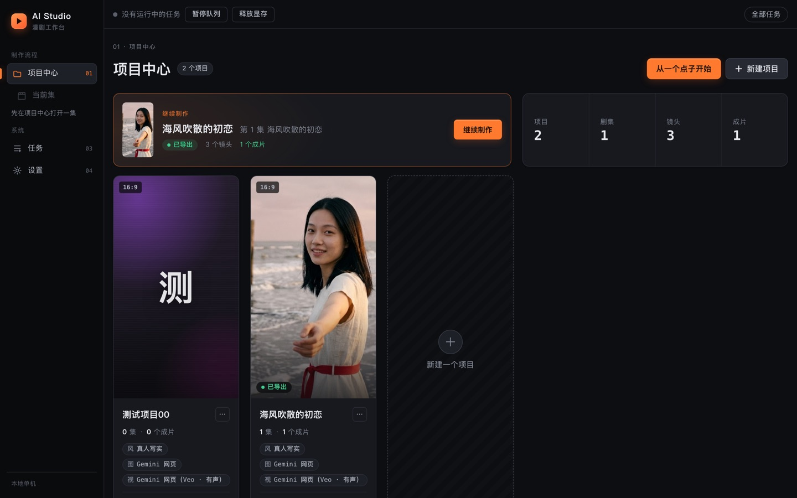

服务起来后可以先跑一遍环境检查（和设置页「环境检查」是同一份结果）：

```bash
uv run studio doctor
```

## 2. 加载浏览器扩展

只用本机 ComfyUI 或 API 时可以跳过这一步。要用网页版（ChatGPT、Gemini、Muse、Claude 写文本，即梦、可灵出视频）时：

1. 在你平时用的 Chrome 或 Edge 打开 `chrome://extensions`（Edge 是 `edge://extensions`），打开「开发者模式」；
2. 点「加载已解压的扩展程序」，选仓库里的 `browser-extension` 目录；
3. 在这个浏览器里登录要用的网站。

扩展通过 `ws://127.0.0.1:8700/api/browser/ext` 连本机服务，在已登录的标签页里操作、把原图 / 原视频传回来。
studio 不启动浏览器，也不读取 cookie。连没连上、各网站登没登录，在设置页「网页出图（浏览器扩展）」里看：

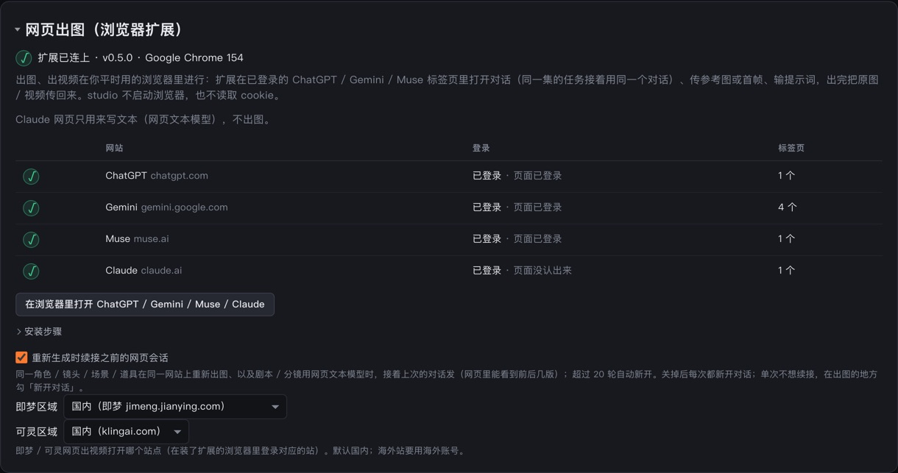

- 「在浏览器里打开 ChatGPT / Gemini / Muse / Claude」：一次打开几个网站的标签页，方便登录；
- 「重新生成时续接之前的网页会话」：同一角色 / 镜头 / 场景 / 道具在同一网站上重新出图时接着上次的对话发，超过 20 轮自动新开；
- 「即梦区域」「可灵区域」：国内站还是海外站（Dreamina / kling.ai），海外站要用海外账号。

> 扩展会在你登录的网页上自动操作，部分网站的服务条款限制自动化使用，账号可能因此受限，请自行评估。用掉的是你自己账号的额度。

## 3. 配置引擎（设置页）

左侧栏「设置」。页面从上到下是：默认模型、API 服务、环境检查、网页出图、引擎、当前配置（只读）。
设置页只管默认，项目和镜头上选的总是优先；改了马上生效，不用重启。

### 默认模型

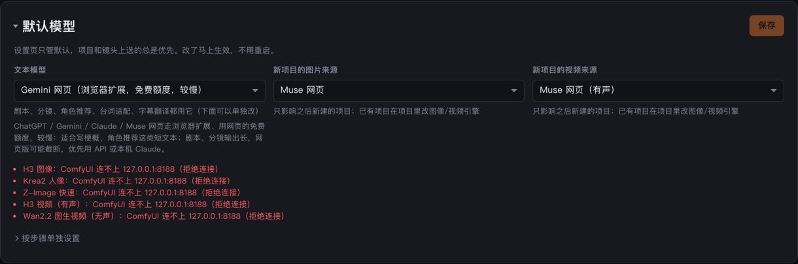

- **文本模型**：剧本、分镜、角色推荐、台词适配、字幕翻译都用它。可以选本机 Claude Code、本机 LM Studio、
  OpenAI / Anthropic / Gemini API、网页版 ChatGPT / Gemini / Claude / Muse，或「手动」（自己把提示词贴给任意模型，再把结果贴回来）。
- **新项目的图片来源 / 新项目的视频来源**：只影响之后新建的项目；已有项目在项目里改。
- 「按步骤单独设置」展开后，剧本、分镜、角色定妆照、三视图、场景图等每一步可以单独指定。

### API 服务

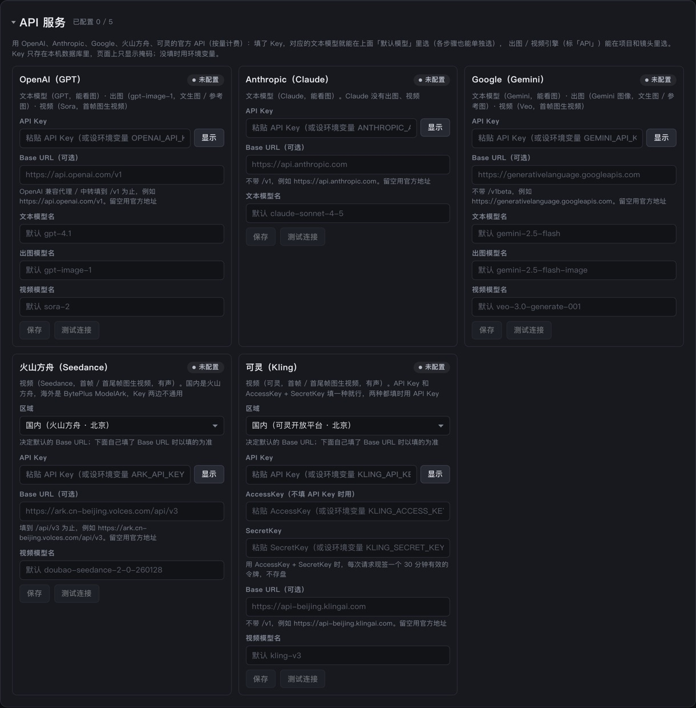

OpenAI（GPT）、Anthropic（Claude）、Google（Gemini）、火山方舟（Seedance）、可灵（Kling）五家，填了 Key 对应的文本模型、
出图 / 视频引擎就能选。每家可以填 Base URL（代理 / 中转）和模型名；火山方舟和可灵还要选区域（国内 / 海外）；
可灵可以填 API Key，也可以填 AccessKey + SecretKey。

- Key 存在本机数据库里，页面上只显示掩码；不填时读环境变量（`OPENAI_API_KEY`、`ARK_API_KEY`、`KLING_API_KEY` 等，完整列表见 README「引擎配置说明」）。
- 「测试连接」调这家的只读接口（列模型 / 查任务列表），不生成内容、不扣费。

### 环境检查

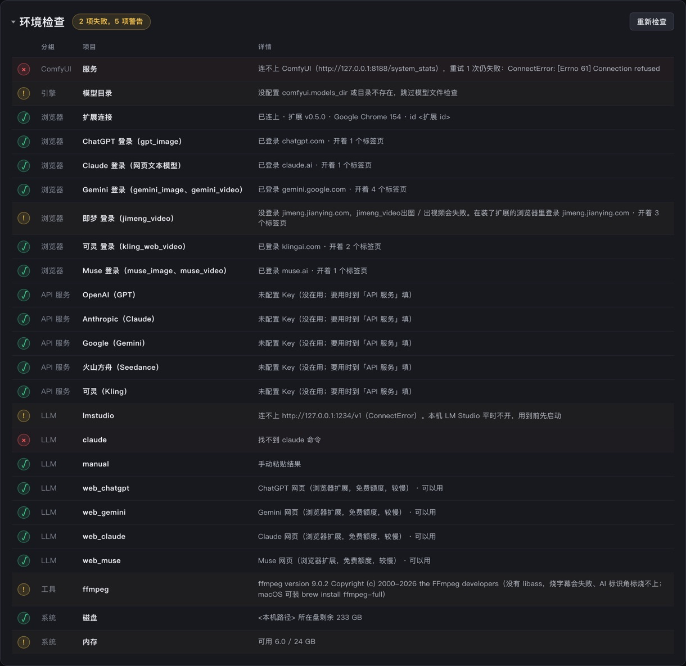

逐项检查 ComfyUI、模型目录、浏览器扩展和各网站登录、API Key、文本模型、ffmpeg（有没有 libass）、磁盘、内存。
截图里 ComfyUI 没开、ffmpeg 不带 libass，所以有失败和警告：这台机器只用网页引擎，照样能出片，但 AI 角标烧不上（见第 13 节）。

### 引擎表

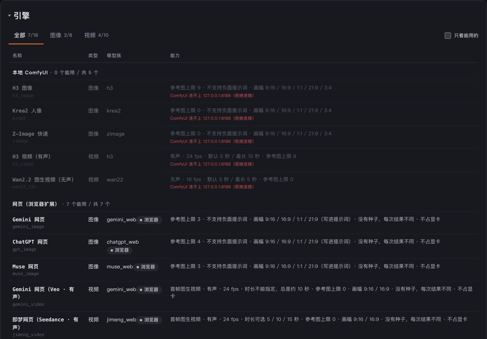

按来源（本地 ComfyUI / 网页（浏览器扩展）/ API）列出所有出图、出视频引擎和能力：参考图上限、画幅、能不能指定时长、有没有声音、
占不占显卡。用不了的灰掉并写原因；勾「只看能用的」只显示现在能用的。

## 4. 从一个点子开始（向导）

项目中心右上角「从一个点子开始」，四步：**点子 → 方向 → 梗概 → 确认**。

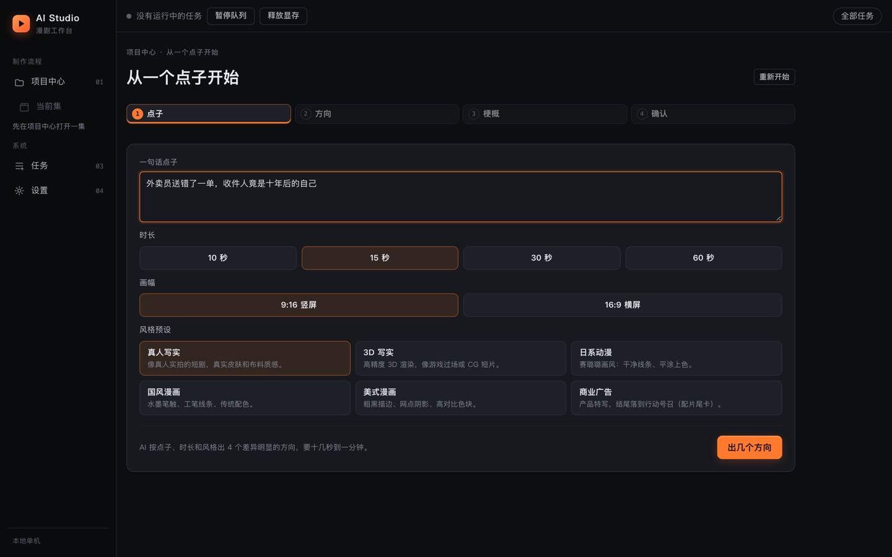

1. **点子**：写一句话点子，选时长（10 / 15 / 30 / 60 秒）、画幅（9:16 竖屏 / 16:9 横屏）、风格预设（真人写实、3D 写实、日系动漫、
   国风漫画、美式漫画、商业广告），点「出几个方向」，AI 出 4 个差异明显的方向；
2. **方向**：挑一个「用这个方向写梗概」，也可以选两个「合并这两个写梗概」，或「补一句要求重出」；
3. **梗概**：可以直接改，或写修改要求让 AI「按要求改写」；
4. **确认**：点「开始制作」，建好项目，写剧本和分镜，然后跳到工作台。

分镜做好后工作台上方会提示「分镜做好了：看一下分镜和角色，没问题点「继续出片」」，点了就依次出角色定妆照 → 首帧 → 视频 → 导出。

## 5. 项目与剧集

不走向导也可以：项目中心「新建项目」，再在项目页「新建剧集」，贴原文或梗概、填目标时长，创建后在工作台的剧本阶段生成剧本。
框里没内容时可以让 AI「写梗概」，有内容时「续写」。

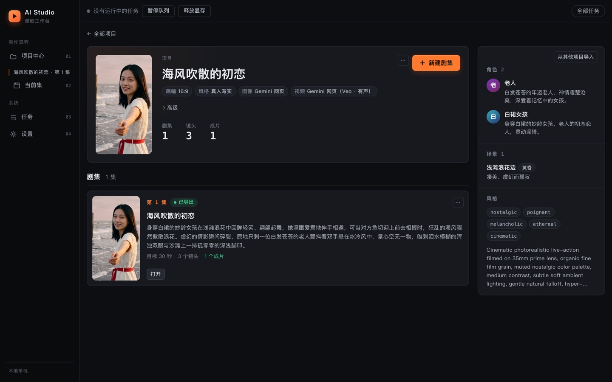

项目页显示画幅、风格、默认图像 / 视频引擎、剧集列表，右栏是项目设定（角色、场景、风格）。
「…」菜单里有「项目设置」「改名」「归档」；每个项目可以分别选默认的图片、视频来源，每个镜头也能单独换。

点剧集的「打开」进**单集工作台**。工作台顶部五个阶段：**剧本 → 角色 → 首帧 → 视频 → 成片**，右边是唯一的主按钮「下一步：…」。
标题旁边的「一键出完剩下的」见第 14 节。

## 6. 剧本与剧本体检

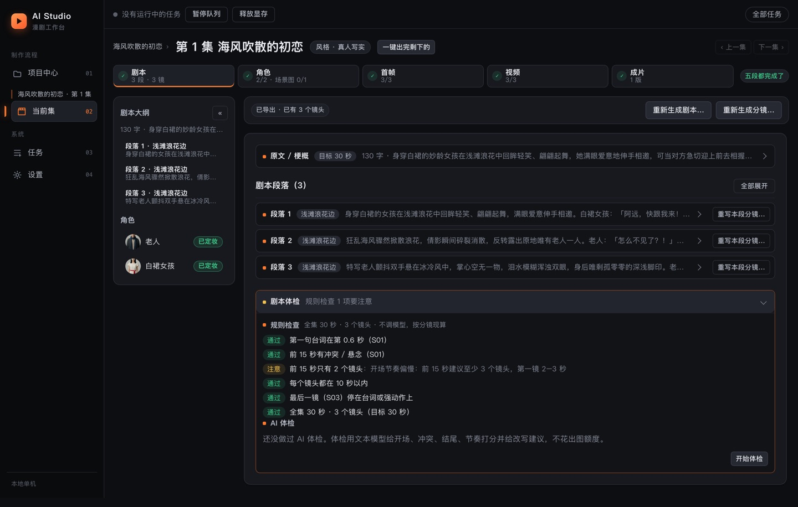

- 「原文 / 梗概」可以展开改；「重新生成剧本…」「重新生成分镜…」整集重来；每个段落右边「重写本段分镜…」只改这一段。
- **剧本体检**（在剧本段落下面，默认收起）：花出图、出视频额度之前先看一眼。
  - **规则检查**不调模型、打开就有：第一句台词在第几秒、前 15 秒有没有冲突 / 悬念、前 15 秒几个镜头、有没有超过 10 秒的镜头、
    最后一镜是不是停在台词或强动作上、总时长和目标差多少；
  - **AI 体检**：点「开始体检」，文本模型按开场钩子（前 15 秒）、冲突与爽点密度、结尾卡点、节奏打分并给改写建议，不花出图额度。

## 7. 角色：定妆照、三视图、造型

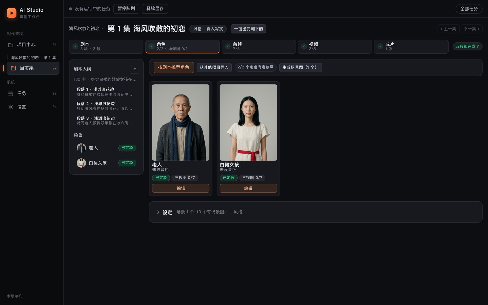

角色阶段工具栏：「按剧本推荐角色」「从其他项目导入」、定妆进度、「生成场景图」。每个角色卡片显示有没有定妆、三视图几格，点「编辑」打开角色抽屉，三个页签：

**造型**：定妆照条。选张数和引擎点「抽卡」，或「上传定妆照」，或「AI 推荐造型」。点「设为当前造型」才会换；
出场镜头的首帧和视频会用选定的这张锁脸。换了造型可以点「把镜头里的外貌更新为当前造型」。

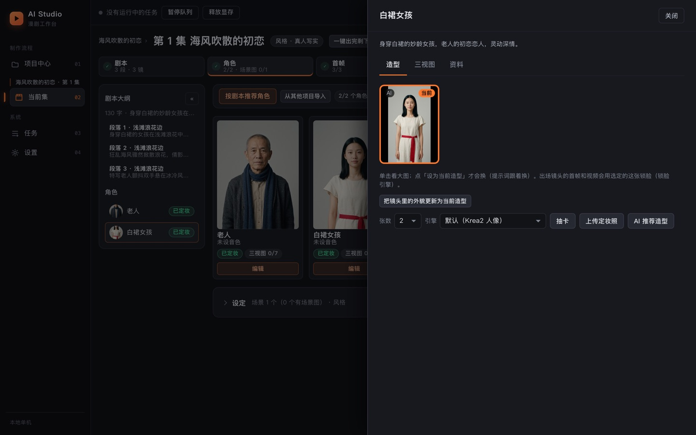

**三视图**：一张设定图出同一个人的正面、3/4、侧面、背面（另一张出正脸、3/4、侧脸），用定妆照锁脸，自动切成单个视角；
出场镜头的首帧和视频按景别 / 机位带上最匹配的一格。可以「AI 整理全身描述」后「全部生成」，单张也能「生成」「重新切图」。

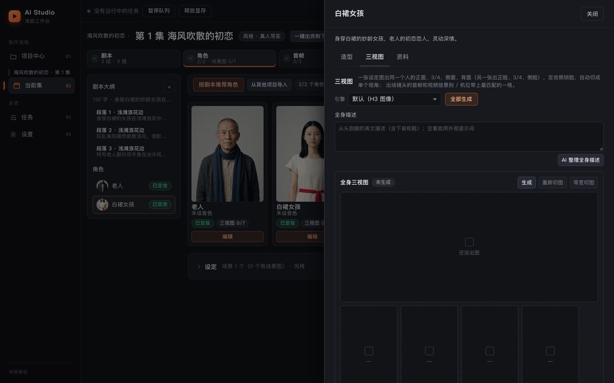

**资料**：名字、人物描述、核心特征、配音音色（Edge TTS 音色，如 `km-KH-PisethNeural`，留空不配音）。

## 8. 场景与道具

角色阶段下方的「设定」展开后是场景、道具和风格：

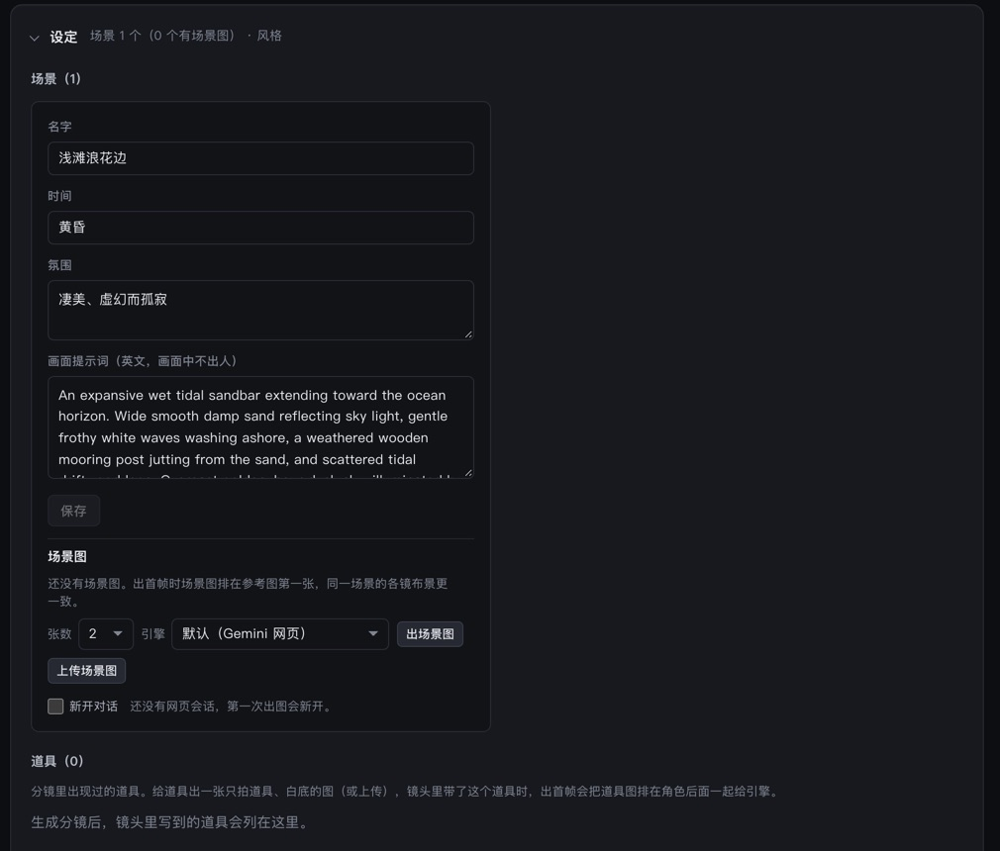

- **场景**：名字、时间、氛围、画面提示词（英文，画面中不出人）。「出场景图」或「上传场景图」。出首帧时场景图排在参考图第一张，同一场景的各镜布景更一致。
- **道具**：分镜里出现过的道具会列在这里。给道具出一张只拍道具、白底的图（或上传），镜头里带了这个道具时，出首帧会把道具图排在角色后面一起给引擎。
- **风格**：风格锚（注入所有图像 / 视频提示词）、色板、光线、质感、角色规则、情绪关键词、负面提示词。

## 9. 分镜与镜头抽屉

首帧、视频阶段都按段落列出镜头卡片，点卡片打开**镜头抽屉**：

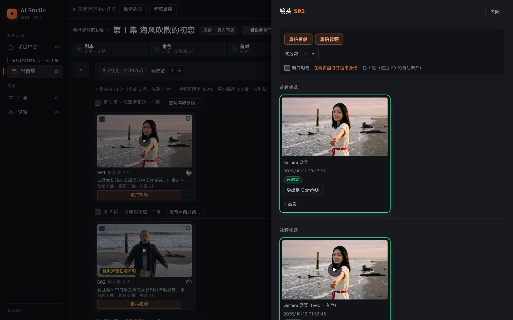

上半部分是「重拍首帧」「重拍视频」、候选数、「新开对话」（网页引擎时），下面是首帧候选和视频候选（绿框是选定的）。
候选的「高级」里能看参数；首帧候选还有「导出到 ComfyUI」，方便在 ComfyUI 里接着修。

往下滚是镜头自己的设置：

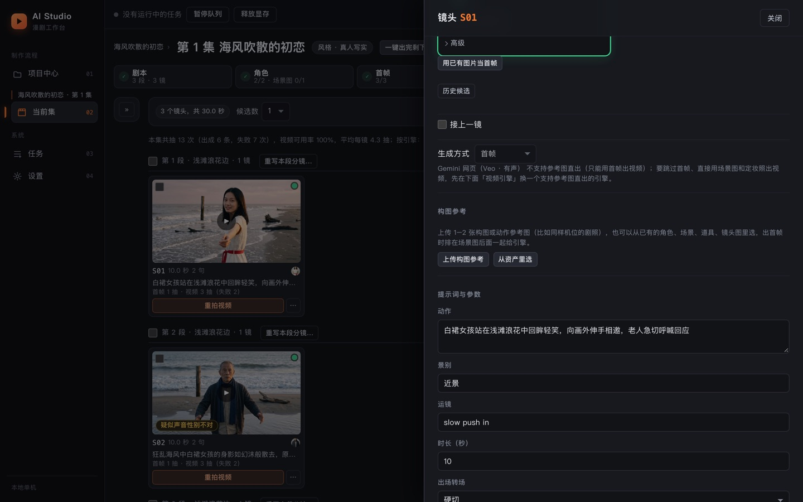

- **用已有图片当首帧** / **历史候选**：不重新出图，直接用已有的图。
- **接上一镜**：首帧取上一镜选定视频的最后一帧，背景、人物位置接得上（第一镜不能开）。
- **生成方式**：「首帧」（先出首帧再图生视频）或「参考图直出」（不出首帧，用场景图 → 构图参考 → 定妆照 / 三视图 → 道具图直接出视频）。
  当前视频引擎不支持参考图直出时这一项禁用并说明；目前引擎表里支持的是 Seedance API（`seedance_video`）和 Gemini / Muse 网页
  （截图是这一版之前截的，那时 Gemini 网页还不支持）。
- **多拍镜头**：固定时长引擎（Gemini、Muse）下，一个镜头就是一次生成，里面按时间戳切 2–4 拍；卡片上显示「3 拍」，
  抽屉里能看 / 改每一拍（开始、结束、景别、运镜、动作）。镜头比一次生成短时，抽屉提醒会浪费几秒，并给「并进下一镜做成多拍镜头」。
- **构图参考**：每镜最多 2 张构图 / 动作参考图（「上传构图参考」或「从资产里选」），出首帧时排在场景图后面一起给引擎。
- **提示词与参数**：动作、景别、运镜、时长、出场转场；图像提示词里的 `{{char:N}}` 是角色外貌占位符，出图时按景别换成角色当前造型。
- **图像引擎 / 视频引擎**：这一镜单独换引擎。**引擎建议**：当前引擎不满足这一镜的硬性要求（有台词没声音、要尾帧不支持……）
  或镜头较难时，「视频引擎」下面会出一行「建议：…」和「用这个」按钮（只改草稿，不自动保存）；视频阶段工具栏上会显示「N 镜建议换引擎」。
- **对白与字幕**：每句台词的中文、高棉语译文和「母语已校对」。

## 10. 首帧


首帧阶段每个镜头出首帧图（「候选数」可以一次出 1–4 张），出图时自动带上场景图、构图参考、角色定妆照 / 三视图、道具图作参考。
卡片上「重拍首帧」单镜重来；勾选几个镜头（或段落标题旁的复选框全选本段）后，阶段条的「下一步」只对选中的镜头。选了「参考图直出」的镜头这一格不出图。

## 11. 视频与抽卡统计

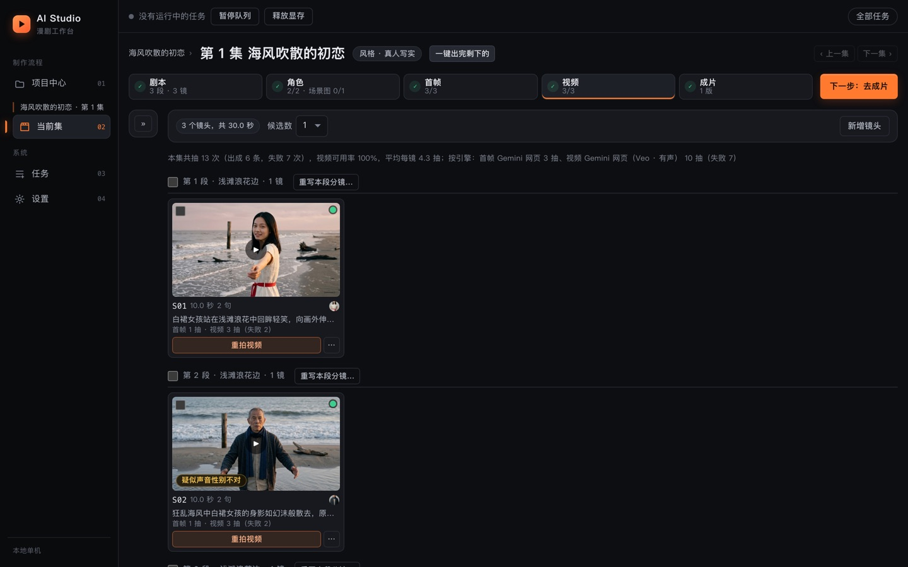

视频阶段每个镜头用选定的首帧图生视频；不满意就「重拍视频」，再抽一次。

**抽卡统计**在工具栏下面一行，例如截图里：「本集共抽 13 次（出成 6 条，失败 7 次），视频可用率 100%，平均每镜 4.3 抽；按引擎：…」。
每张镜头卡片也写着「首帧 1 抽 · 视频 3 抽（失败 2）」。用它看哪个引擎更费额度、哪一镜反复失败，决定换引擎还是改提示词。

视频出完会自检，有问题的镜头卡片上会出角标：开头没接上首帧、疑似跳切、疑似声音性别不对（截图里 S02 就有一个）。

## 12. 配音、配乐、字幕、片尾卡

都在成片阶段的「导出选项」里（截图见下一节）：

- **字幕**：中文字幕、高棉语字幕（在中文下面）、字幕对齐实际说话；
- **配音**：高棉语配音（Edge TTS，用角色资料里的配音音色）、保留原声底（原声压低垫在下面）、配音对齐实际说话；
- **配乐**：「上传配乐」（mp3 / wav / m4a / aac / ogg / flac，循环铺满整集），勾「成片垫配乐」，可调音量、淡入淡出，「有台词时自动压低」；
- **片尾卡**：勾「成片末尾接片尾卡」后可以改片尾卡的文字、字体、字号和时长（整个项目共用）。

「高棉语工具」：「翻译高棉语字幕」（AI 译稿，要请母语者校对）、「按高棉语时长改写中文」（让口型跟着高棉语配音的长短走，改完要回视频阶段重新生成）。

## 13. 导出：AI 标识与元数据

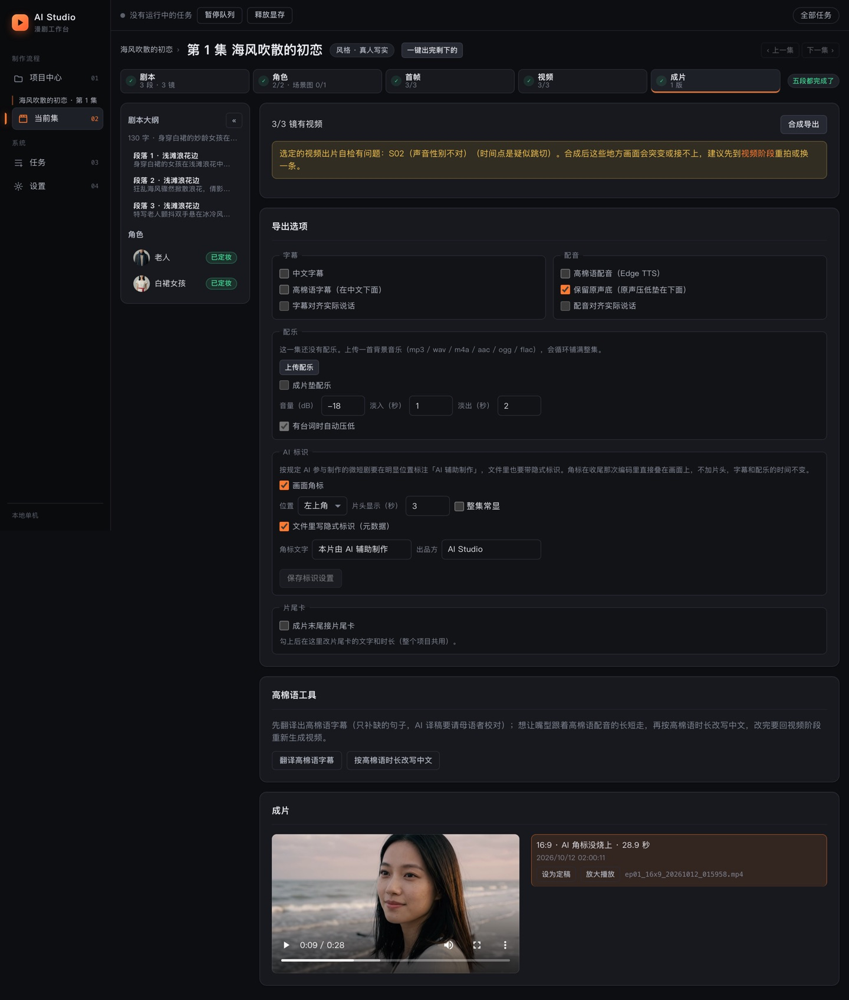

- **AI 标识**默认开：「画面角标」（位置、片头显示几秒或「整集常显」，角标文字默认「本片由 AI 辅助制作」）和
  「文件里写隐式标识（元数据）」（出品方等写进成片文件）。依据是《人工智能生成合成内容标识办法》和 GB 45438-2025，
  实现说明在 `backend/post/aigc.py`。**不要关掉后再去发布**，具体要求以主管部门和平台的最新规定为准。
- 点「合成导出」，任务跑完在下面「成片」里播放，可以「设为定稿」「放大播放」。每一版成片会标出画幅、时长、有没有烧上角标等。
- 截图里那一版写着「AI 角标没烧上」：这台机器的 ffmpeg 不带 libass，角标烧不进画面（元数据照常写）。换一个带 libass 的 ffmpeg 再导出即可。
- 导出前如果选定的视频有自检问题，上方会有黄色提示，建议先回视频阶段重拍或换一条。

## 14. 一键出完剩下的

工作台标题旁的「一键出完剩下的」：出镜角色缺的定妆照 → 首帧 → 视频 → 导出，一次排进任务队列；已经出好、没改过的镜头跳过。会用掉出图 / 视频额度。

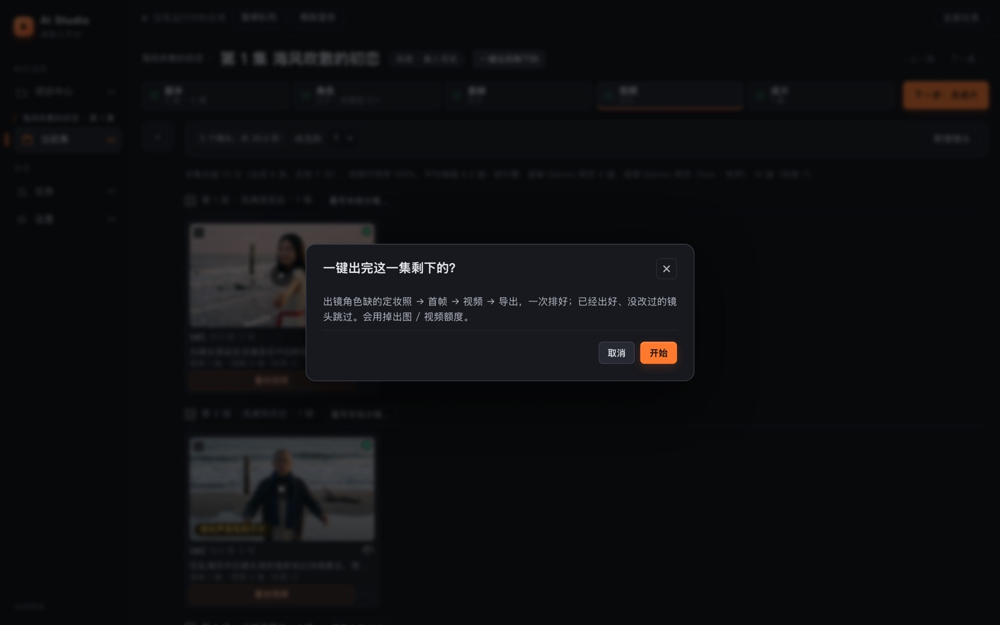

命令行也一样：`uv run studio run all <项目> -e 1`。

## 15. 任务页

左侧栏「任务」：所有任务按天列出，可按状态（运行中 / 排队 / 失败 / 完成 / 已取消）、类型、项目筛选，也能搜任务名、镜头号、`#编号`。

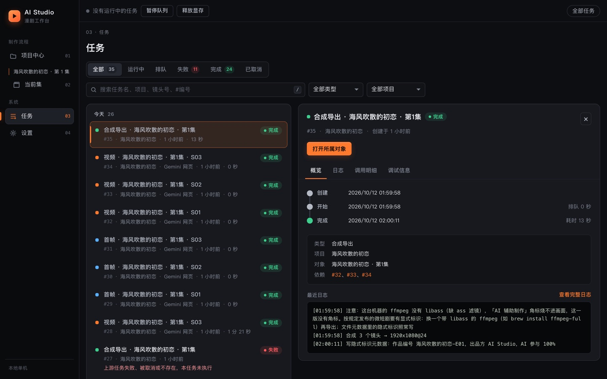

任务详情有四个页签：**概览**（时间线、依赖的任务、最近日志）、**日志**、**调用明细**（每次调用引擎 / 模型的输入输出）、**调试信息**。
「打开所属对象」跳回对应的镜头或剧集。文本模型选「手动」时，任务会停在这里等你把结果贴回来。

## 16. 续季：从其他项目导入资产

项目页右栏或角色阶段的「从其他项目导入」：把以前项目的角色（定妆照、三视图、声音）、场景图、道具图复制到这个项目，复制后两边互不影响。适合做续季、番外。

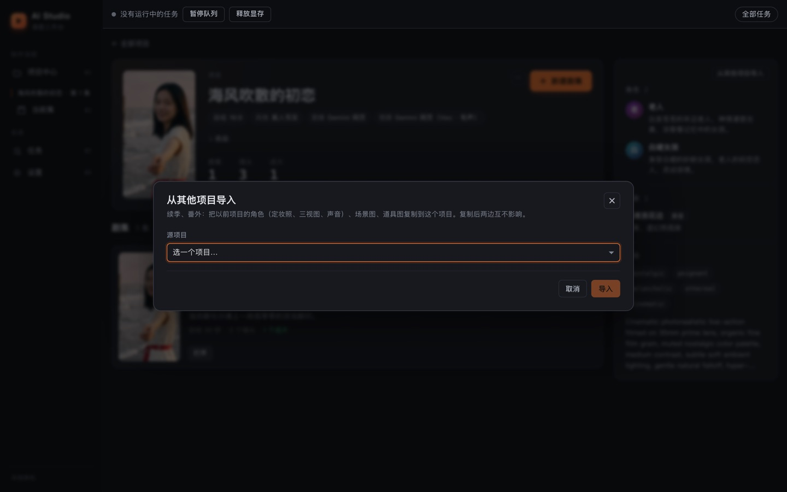

## 17. 常见问题

- **ComfyUI 没连上**：页面顶部会有黄色提示，只是本机引擎用不了，网页 / API 引擎不受影响。不用 ComfyUI 时可以关掉提示。
- **扩展没连上 / 网站显示没登录**：确认扩展加载在你登录网站的那个浏览器里；扩展更新后在 `chrome://extensions` 点「重新加载」。
- **AI 角标、字幕烧不上**：ffmpeg 没带 libass。macOS 可装 `ffmpeg-full`，然后在 `config.yaml` 的 `ffmpeg.ffmpeg` 写完整路径。
- **网页引擎报「页面没认出来」或选择器错误**：网站改版了，见 [CONTRIBUTING.md 的「网站改版 / 选择器失效」](../../CONTRIBUTING.md#网站改版--选择器失效)。
- **字幕字体不对**：`config.yaml` 的 `subtitles.zh_font` 默认是 Windows 字体，macOS / Linux 换成本机有的字体。
- 启动、重启、健康检查、数据库备份 / 回滚、日志位置、升级流程：见 [运维手册](../RUNBOOK.md)。
