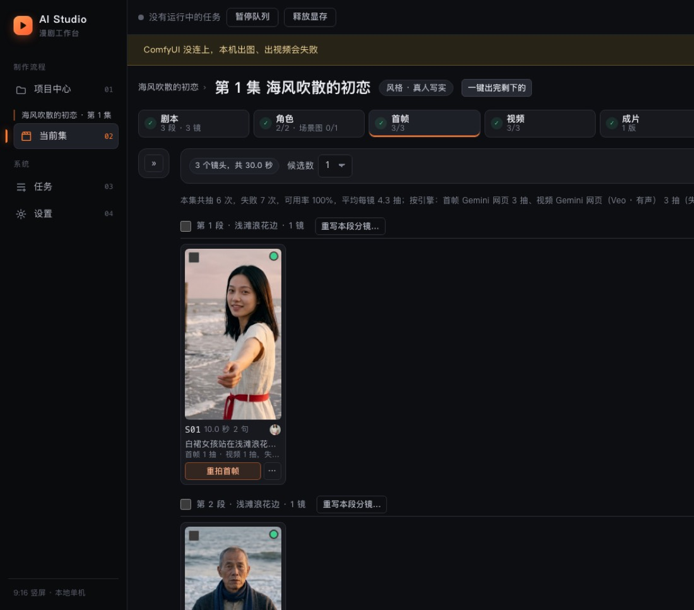
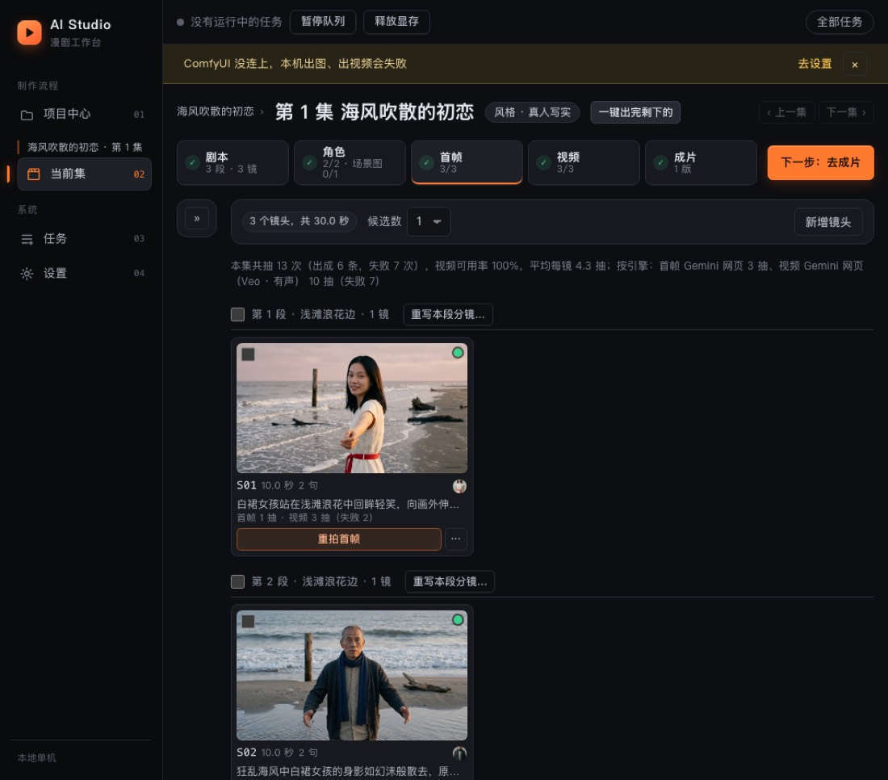
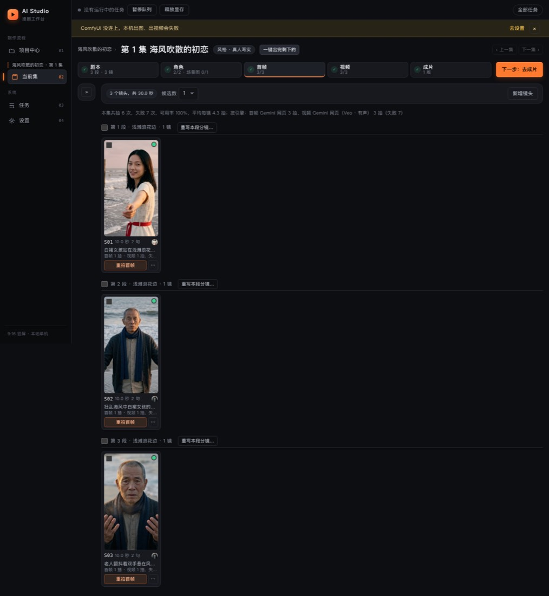
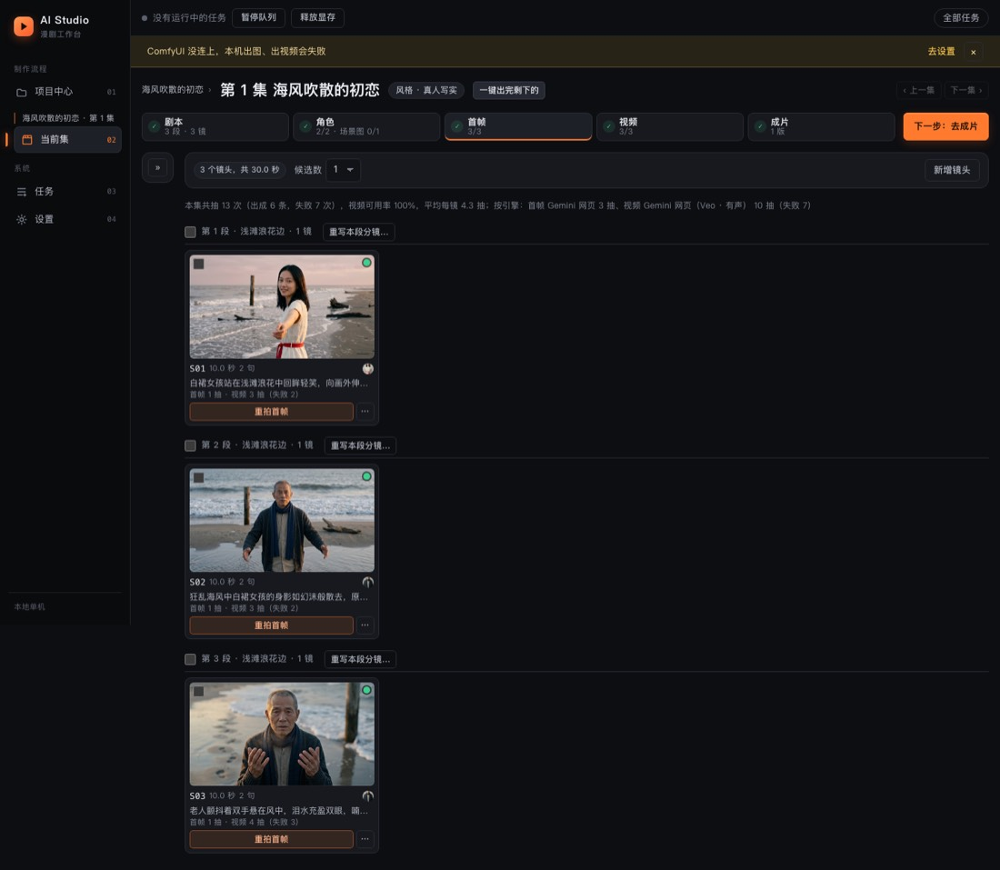
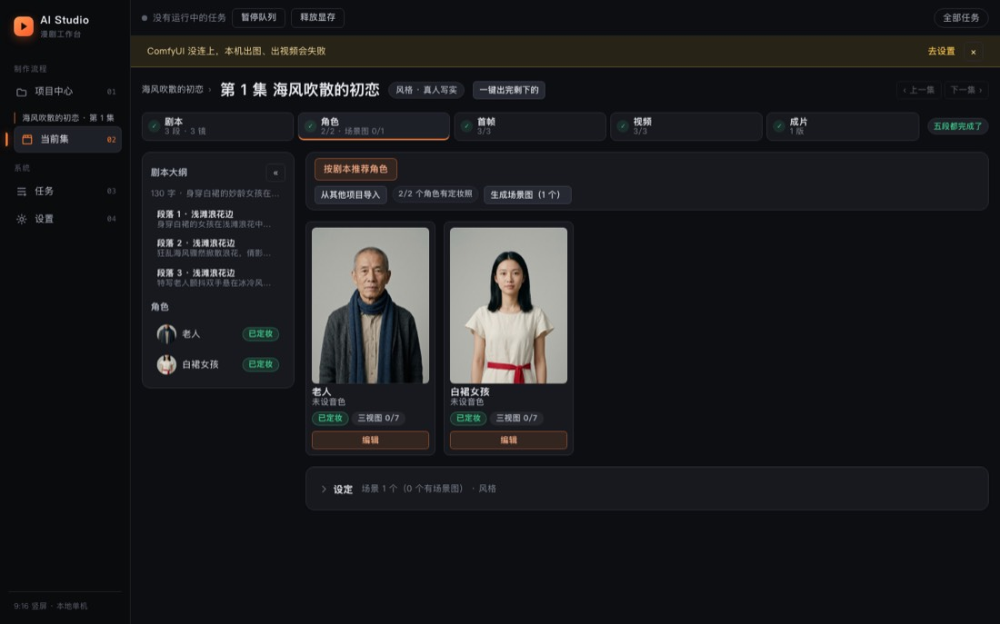
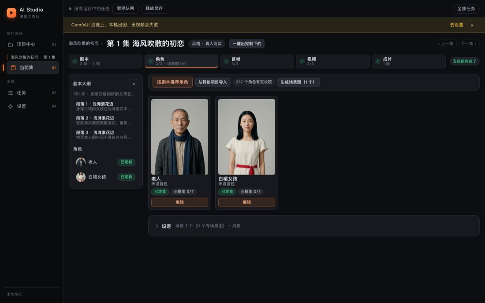
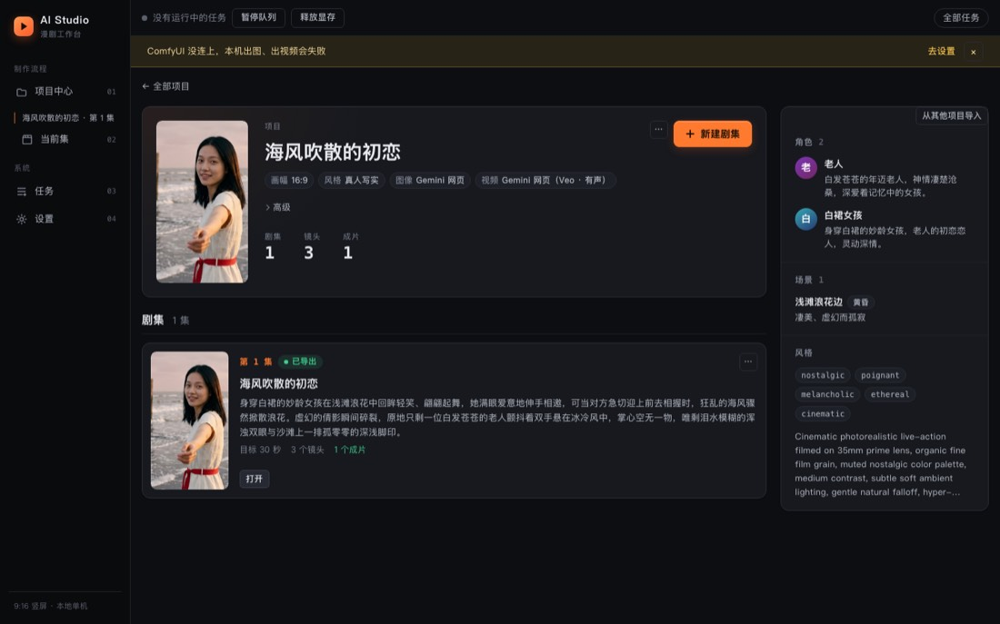

# UI / UE 全量走查（2026-10-12）

## 怎么测的

- **e2e 冒烟 + 布局守卫**（`cd frontend && npx playwright test`，临时后端 + manual LLM）：开始时 4 个失败 + 3 个没跑，修完 8 个全过（布局守卫新加了 1024 宽）。
- **只读走查真实服务**（127.0.0.1:8700，项目「海风吹散的初恋」已出片、「测试项目00」空项目）：Playwright 自带 Chromium 逐页打开，所有非 GET 的 `/api` 请求一律拦掉，不点任何会提交任务 / 改数据的按钮。页面：项目中心、项目页（有剧集 / 空项目）、`/start` 点子向导、单集工作台五个阶段（剧本 / 角色 / 首帧 / 视频 / 成片）+ 角色抽屉 + 镜头抽屉、任务页（列表、详情的概览 / 日志 / 调用明细）、设置页、404。宽度 1440 / 1280 / 1024 / 390，整页截图，同时收集控制台报错、失败请求、横向溢出、超出视口的元素、没有可读名字的按钮 / 输入框、没有 alt 的图片、多个主按钮、中文界面里的英文残留。
- 走查脚本放在会话临时目录（不进仓库）；修完后同一脚本再跑一遍做前后对比。

自动检查的结论：控制台没有报错；失败请求只有视频 / 成片 `<video preload>` 被页面切换中断的 `ERR_ABORTED`（正常）；没有发现缺可读名字的按钮或缺 alt 的图片（「裁剪文字」命中的都是 `.visually-hidden` 读屏文字，误报）。

## 问题清单

| 问题 | 页面 / 宽度 | 严重程度 | 处理 |
|---|---|---|---|
| e2e：4 个用例卡在「等不到分镜完成」。分镜校验早已要求 `image_prompt` 里写角色外貌占位符 `{{char:N}}`、不许抄外貌，fixture 还是抄外貌的老写法，manual LLM 一直打回重问 | e2e | 高 | **已修**（测试过时，不是应用回归）：fixture 先写 `CHAR`，交给模型前按这次提示词角色表里的占位符换掉；API 和任务页两条路都换 |
| 16:9 项目的首帧 / 视频在镜头卡片和镜头抽屉里被裁成 9:16 竖条（`object-fit: cover`），画面两边的人和景都看不到，没法判断构图 | 工作台首帧 / 视频阶段、镜头抽屉 / 全部宽度 | 高 | **已修**：工作台根节点带项目画幅 `data-aspect`，16:9 项目的镜头缩略图、抽屉候选按 16:9 显示，卡片列宽相应放宽（[前](ui-audit/02-keyframes-16x9-before.jpg) / [后](ui-audit/02-keyframes-16x9-after.jpg)） |
| 1024 宽整页横向滚动，「下一步」主按钮在视口外（`body { min-width: 1200px }`） | 所有页面 / 1024 | 高 | **已修**：最小宽度降到 1024，逐页确认 1024 下不溢出；布局守卫 e2e 加上 1024 宽（[前](ui-audit/01-keyframes-1024-before.jpg) / [后](ui-audit/01-keyframes-1024-after.jpg)） |
| 抽卡统计读起来自相矛盾：「本集共抽 6 次，失败 7 次，可用率 100%」（6 是出成的条数，失败另算；可用率只算视频） | 首帧 / 视频阶段工具栏下、镜头卡片 / 全部宽度 | 中 | **已修**：「抽」一律指尝试次数——「本集共抽 13 次（出成 6 条，失败 7 次），视频可用率 100%…」；镜头卡片「视频 3 抽（失败 2）」，按引擎同理 |
| 成片播放器写死 9:16 竖框，16:9 成片缩在竖框中间一条 | 成片阶段 / 全部宽度 | 中 | **已修**：播放框按成片画幅（variant `16x9` / `9x16`）定比例，横屏框宽 `clamp(240px, 30vw, 420px)` |
| 任务列表 / 详情里的引擎有时是内部 id（`gemini_web`），有时是中文名（「Gemini 网页」）：payload 没写引擎时退回模型族、没翻译 | 任务页 / 全部宽度 | 中 | **已修**：模型族也走 `engineLabel`（已有中文名表），不认识的照原样 |
| 页头编号和侧栏不一致：任务页「04 · 任务」、设置页「05 · 设置」，侧栏是 03 / 04 | 任务、设置 / 全部宽度 | 中 | **已修**：改成 03 / 04 |
| 设置页引擎表「类型」列太窄，「图像」「视频」竖着折成两行 | 设置 / 1440 及以下 | 中 | **已修**：该列不换行 |
| 项目页右栏「从其他项目导入」贴在侧栏边框上，像是溢出来的 | 项目页 / 全部宽度 | 中 | **已修**：按钮行留和下面各块一样的内边距（[前](ui-audit/04-project-bible-before.jpg) / [后](ui-audit/04-project-bible-after.jpg)） |
| 角色阶段工具栏「按剧本推荐角色」独占一行，其他按钮挤到第二行 | 角色阶段 / 全部宽度 | 低 | **已修**：没有推荐列表 / 报错时和其他按钮排一行，出了推荐列表才独占整行（[前](ui-audit/03-cast-toolbar-before.jpg) / [后](ui-audit/03-cast-toolbar-after.jpg)） |
| 设置页收起的面板（API 服务、当前配置）缩成标题那么宽，和展开的面板不对齐 | 设置 / 2100 以下 | 低 | **已修**：去掉单列布局下的 `align-self: start`（宽屏两列 grid 本来就 `align-items: start`） |
| 侧栏底部写死「9:16 竖屏 · 本地单机」，16:9 项目里也这么写 | 全部页面 | 低 | **已修**：只写「本地单机」（画幅是每个项目自己的） |
| 空项目提示里的引号是“新建剧集”，其他地方都用「」 | 空项目页 | 低 | **已修** |
| 项目中心有两个主按钮：页头「从一个点子开始」+ 继续制作卡片里的「继续制作」 | 项目中心 / 全部宽度 | 低 | **留待决定**：「下一步唯一主按钮」的规矩目前只约束工作台；项目中心两个入口都算主路径（新手 / 回访），要不要把其中一个降成次按钮，需要产品上定 |
| 390 宽（手机）整页横向滚动，基本不可用 | 所有页面 / 390 | 低 | **留待决定**：这是本机桌面工具，页面按 ≥1024 设计；要做手机端（比如只看进度、看成片）是单独的需求 |
| 项目卡片封面固定 9:16 竖图，16:9 项目也是竖封面（角标写着 16:9） | 项目中心 | 低 | **留待决定**：卡片网格要整齐，封面统一比例是有意的设计；若要按画幅显示需要改卡片布局 |
| 任务详情「调用明细」里，没有调用的任务显示一条可展开的「#1 没有调用记录」 | 任务页 | 低 | **不改**：后端有意记的一条说明（展开有原因：输入没变跳过 / 调用前就出错），信息有用 |
| 设置页不可用引擎的行整体 45% 透明，下面的英文 id 几乎看不清 | 设置 / 全部宽度 | 低 | **留待决定**：灰掉是为了突出能用的引擎；id 主要给排查用，要不要提高对比度看使用习惯 |
| 任务失败原因里出现「浏览器扩展 v?」（版本号拿不到时的占位） | 任务详情日志 | 低 | **留待决定**：后端文案，改成「旧版扩展」之类需要确认扩展握手时哪些字段一定有 |

## 前后对比

| | 修前 | 修后 |
|---|---|---|
| 1024 宽首帧阶段 |  |  |
| 16:9 项目的镜头卡片 |  |  |
| 角色阶段工具栏 |  |  |
| 项目页右栏 |  |  |

## 验证

- `npx playwright test`：8 个全过（1024 / 1280 / 1580 / 1920 / 3412 布局守卫 + 3 个冒烟）。
- `npx tsc --noEmit -p .`、`npx vitest run`、`npm run build` 通过；改了文案 / 行为的地方补了 Vitest（抽卡统计文案、任务引擎中文名、成片播放框比例、页头编号）。
- 修完后同一走查脚本再跑：1440 / 1280 / 1024 下所有页面不再横向溢出，390 宽仍按设计横向滚动。
